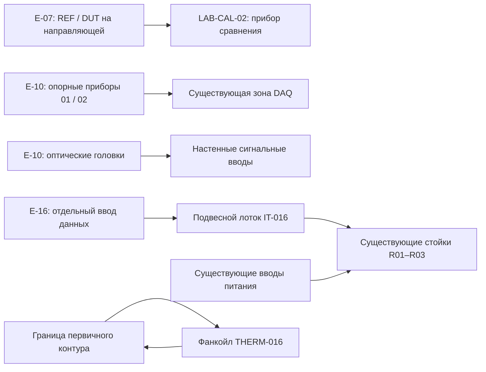

# PROJECT: NULL — этап 3, версия V8

Этот проход реализует специализированное оборудование существующего подземного блока B2. Исходный V6 и оформление V7 сохранены. Полная архитектура всего учреждения и её проверка в Roblox Studio остаются отдельной работой; V8 не объявляет их завершёнными.

Главная камера погружения E-03, четыре акустические башни, кресло и сенсорная рама уже присутствуют в V6/V7. В V8 не создаются их дубликаты. Добавлено недостающее оснащение трёх связанных технических зон.

## Комплект поставки

| Файл | Назначение |
| --- | --- |
| `artifacts/PROJECT_NULL_EXPERIMENTAL_V8.rbxlx` | Полная карта V8; включает все предыдущие версии оборудования и оформления. |
| `artifacts/PROJECT_NULL_STAGE3_V8.rbxmx` | Только группа этапа 3 для переноса в другую копию V7. |
| `artifacts/INSTALL_V8_COMMAND_BAR.luau` | Автономный установщик дополнения в V7 через Command Bar. |
| `artifacts/PROJECT_NULL_V8_COMPARISON.png` | Сравнение геометрии до/после; не снимок из Studio. |
| `artifacts/VALIDATION_V8.json` | Сохранность объектов, ссылки, границы комнат и объёмы движения дверных полотен. |
| `artifacts/GEOMETRY_AUDIT_V8.json` | Проверка ориентированных габаритов нового и существующего оборудования. |

Группы в Explorer: `Equipment → Experimental_Equipment_V8 → E07_Metrology / E10_Experimental_Equipment / E16_Server_Infrastructure`.

## Карточки оборудования

| ID | Место и назначение | Видимый состав | Подключения и обслуживание |
| --- | --- | --- | --- |
| LAB-CAL-02 | E-07; отдельный стенд сравнения сенсорных модулей. | Опорный стол, нижняя полка, выравнивающие опоры, две направляющие, каретки, ходовой винт, маховик, головки REF/DUT, корпус прибора сравнения, эталонные держатели A/B/C. | Экранированные линии головок к прибору; питание под столом до настенной платы. Рабочая сторона обращена в свободный проход. Исходный калибровочный док, компьютер и шкаф сохранены. |
| EXP-P02-01 | Юго-западная часть E-10; опорный прибор вымышленного полевого испытания. | Изолированные опоры, стойки, поперечины, два сегментированных контура, корпус подключения, разъёмы и закреплённый жгут. | Низкая кабельная трасса идёт к существующей зоне DAQ. Прибор стоит вне центрального подхода и зон трёх исходных площадок. |
| EXP-P02-02 | Северо-восточная часть E-10; второй опорный прибор того же стенда. | Тот же тип несущей конструкции, отдельный идентификатор и цветовая маркировка контура. | Отдельный ввод в общую зону подключения; не добавляет отдельную игровую задачу. |
| EXP-P02-03 | Верхние углы E-10; оптические реперы. | Настенные пластины, консоли, подкосы, поворотные опоры, двухобъективные головки, линзовые окна и короткие сигнальные линии. | Заканчиваются у обозначенных настенных вводов; продолжение за стеной не моделируется. Окно наблюдения и исходные панели не закрыты. |
| IT-016 | E-16; разделённая инфраструктура данных трёх существующих стоек. | Лестничный лоток, перекладины, потолочные анкеры, подвесы, пучки линий, три ответвления, кабельные вводы и идентификаторы R01–R03. | Линии данных отделены от существующих вводов питания. Подключения идут к верхним вводам стоек; исходные открываемые лицевые панели не изменены. |
| THERM-016 | Боковая ниша E-16; визуальная концепция локального охлаждения аппаратной. | Напольное основание, корпус фанкойла, сервисная панель, защитные решётки, запорная арматура, маркировка подачи/обратного контура и настенные вводы. | Границы первичного контура показаны у стены; удалённая холодильная установка и расчёт тепловой нагрузки в этот проход не входят. Для доступа к стойкам оставлена центральная зона. |

В новом оборудовании используются встроенные SmoothPlastic и Metal; цилиндры применяются для стержней, оптики и соединений. Изображения, плагины, внешние ассеты и скрытые микросхемы не добавлены.

## Связь систем

Схема описывает видимые подключения и функции моделей. Игровая телеметрия и сетевое взаимодействие между этими системами не реализованы. Шкалы LAB-CAL-02 показывают условные позиции оснастки. На табличках нет вымышленных показаний, выдаваемых за работающие датчики, и нет новых утверждений о природе NULL или истории организации.

## Что проверено автоматически

- Все 7 590 объектов V7 сохранены с прежними свойствами, родителями и порядком исходных дочерних объектов.
- Сохранены 3 серверных скрипта и 195 ClickDetector; новые скрипты и сетевые объекты не добавлены.
- Добавлено 386 деталей: E-07 — 105, E-10 — 153, E-16 — 128. Количество BasePart увеличилось с 6 139 до 6 525, примерно на 6,29%.
- Новые детали закреплены. `CanCollide`, `CanTouch` и `CanQuery` выключены; это визуальные сборки, без новых физических препятствий и целей кликов.
- Проверены числовые значения, положительные размеры, ортонормальность матриц, уникальность referent и разрешимость Ref.
- Проверены границы трёх помещений и объёмы перемещения 20 исходных дверных полотен.
- Пересечений глубже 0,025 stud с видимыми исходными объектами не найдено; отдельно включены 195 целей кликов и 152 носителя дисплеев. Невидимые неинтерактивные коллизионные оболочки исключены из визуального аудита. Цилиндры и MeshPart оцениваются по консервативным ориентированным габаритам.
- Отдельная модель `.rbxmx` содержит ту же группу, что полная карта. Экспорт данных установщика сверяется со всеми свойствами и родительскими связями новых объектов.
- Установщик проверен в Lua VM с имитацией Roblox API: перенос свойств, повторный запуск, отказ без V7, запуск в Play, отказ записи Undo и откат после ошибки.

Эти проверки не измеряют FPS и не подтверждают внешний вид или взаимодействие в настоящем Roblox Studio.

## Приёмка в Roblox Studio

1. Открыть V8 из архива. По очереди выбрать три группы дополнения и нажать F. Проверить таблички, лицевые стороны оптики, опоры и кабельные окончания с уровня персонажа.
2. В E-07 осмотреть направляющую, две головки, прибор и проводку. Убедиться, что рабочий проход и исходный компьютер доступны.
3. В E-10 открыть обе двери, пройти к трём исходным площадкам и выполнить существующее испытание. Проверить клики по датчикам, настройкам и сбросу. Новые опорные приборы и оптические головки имеют только визуальную функцию.
4. В E-16 открыть лицевые панели всех трёх стоек и проверить их доступность; осмотреть раздельные линии данных/питания, верхние вводы и боковой фанкойл. Статический аудит не выполняет анимацию открывания панелей.
5. Сравнить V7 и V8 при одинаковых настройках графики на целевом устройстве: FPS, память, читаемость табличек и видимость при рабочем освещении. Геометрическое превью не воспроизводит материалы и свет движка.
6. При использовании установщика выполнить Undo и убедиться в удалении только `Experimental_Equipment_V8`; затем установить повторно и сохранить отдельную копию карты.

После этой проверки можно переходить к этапу 4 — окружению и лору. Новые сюжетные события и природа NULL требуют отдельного выбора; в V8 они не зафиксированы.
